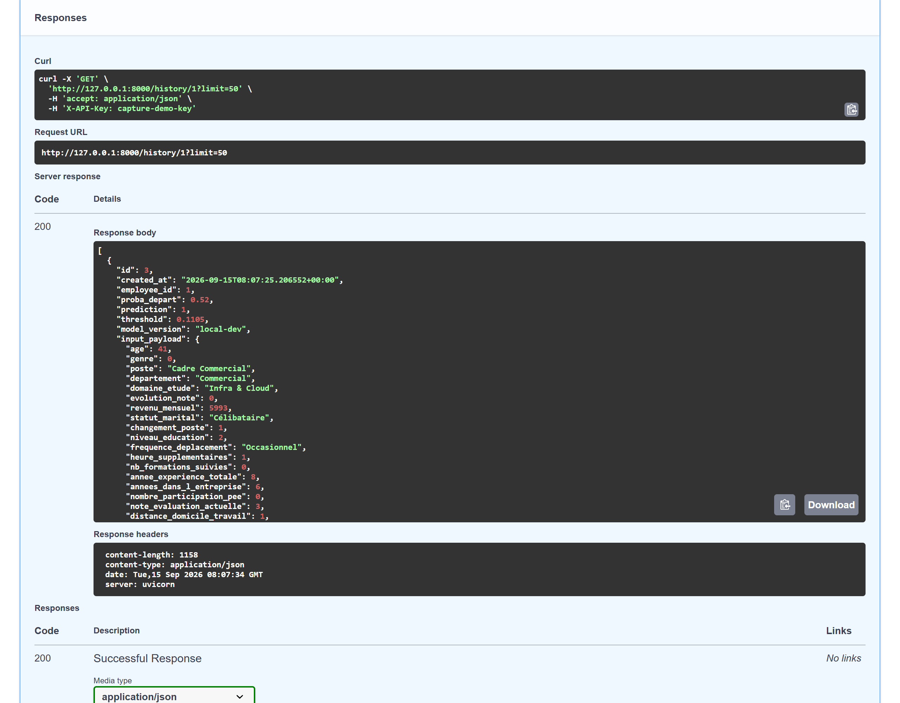
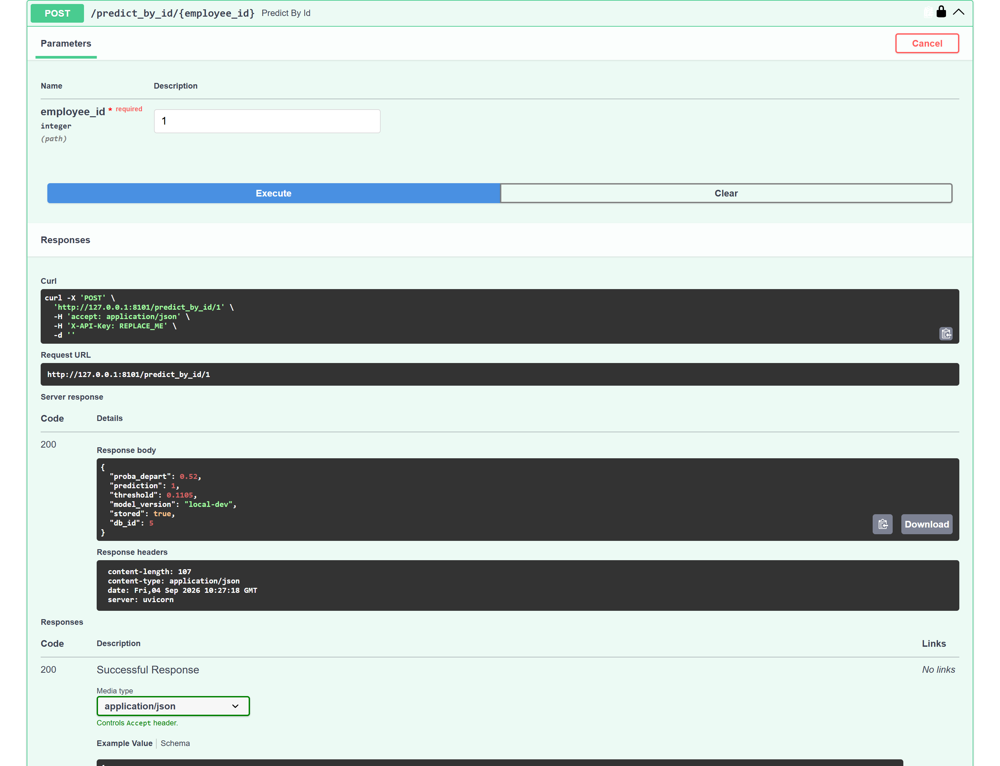
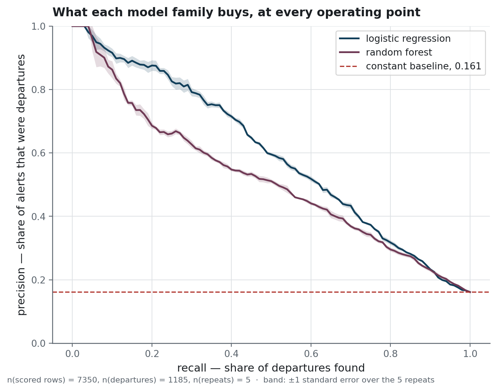
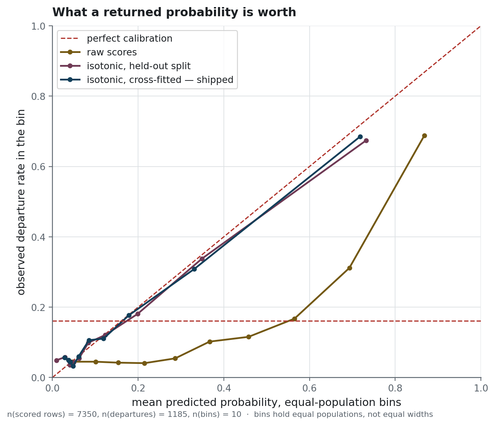
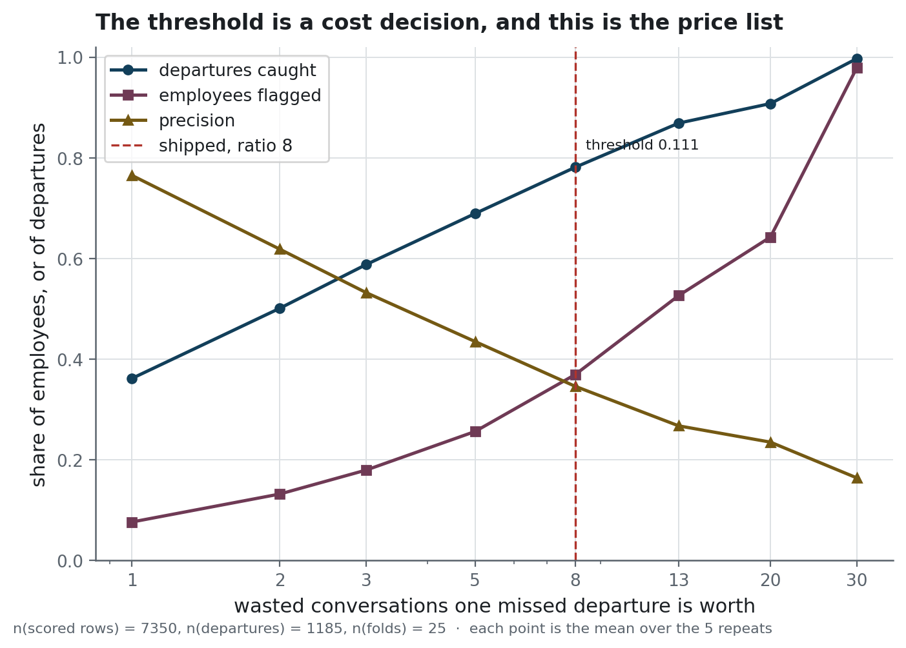
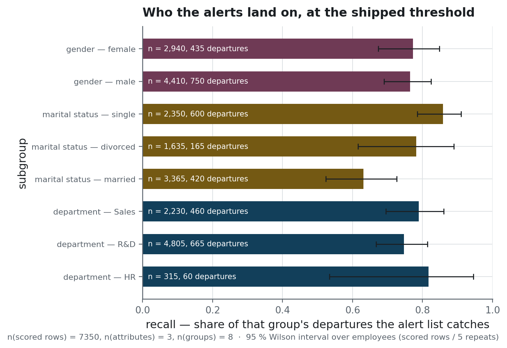
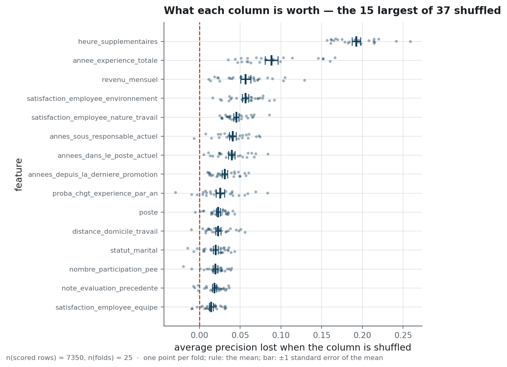
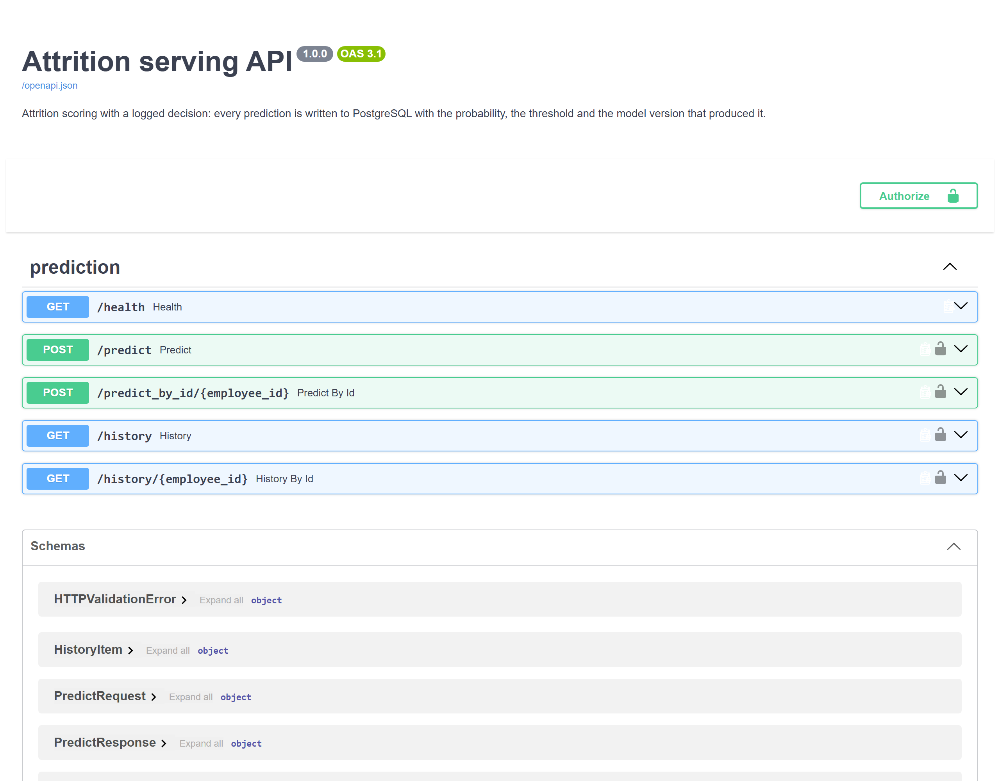

<h1 align="center">Attrition serving</h1>

<p align="center">An HR attrition model behind an API that logs its decisions with the threshold applied to each</p>

<p align="center">
  
  
  
  
</p>

<div align="justify">

**Project status** — finished. The model is a small logistic regression that predicts employee
attrition, that is, which employees will leave. The repository demonstrates the MLOps components that surround such a model in
production: a frozen artefact, a log of the decisions the service makes, and a CI workflow that
tests both. The hosted deployment and the managed database it wrote to have been shut down.
`docker compose up` starts a local PostgreSQL, and the commands under "Running it" start the
service against it. The CI workflow is started by hand. Its last run, on commit 631cdb7, whose
code is the code published here, passed against a PostgreSQL service container.

**No employment decision should be taken from this alert list.** The rows come from a public
sample dataset and describe no real person. The list exists to demonstrate a serving pipeline,
and the decision to rank named employees by their probability of leaving belongs to an
employer.

## The problem

An HR team that wants to retain its employees needs to know who is likely to leave, early
enough to talk to them. A model can rank employees by risk. Turning that ranking into a list
requires a threshold, and the right threshold depends on how much a missed departure costs
compared with a retention conversation held with an employee who would have stayed anyway.
The model cannot estimate that ratio.

A high threshold gives a short list that is mostly right and misses most of the people who
leave. A low threshold catches nearly every departure, with a list that covers nearly the whole
company.

The repository addresses two questions: which threshold the service should apply, and how a
later reader can check the threshold behind each decision.

The data covers 1 470 employees, joined on the employee identifier from three extracts:
contract and demographics, annual reviews, and an internal survey. Of these employees, 237
left, a base rate of 16 %. Predicting "stays" for every employee would reach 84 % accuracy
while finding no departure, so this page reports no accuracy figure.

## What it does

A FastAPI service loads a calibrated logistic regression and exposes five routes. `/health`
reports that the process is alive. `/predict` scores a full feature payload, and
`/predict_by_id` scores an employee already stored in the database. `/history` and
`/history/{employee_id}` return past decisions with their timestamps.

The service writes each prediction to PostgreSQL, together with the probability, the threshold
that turned it into a decision, and the version of the model that produced it. A probability
alone does not show, months later, why a given employee was flagged, and the logged threshold
and model version make that reconstruction possible. The write is best-effort. When it fails,
the prediction is still returned, with `stored: false` in the response.

<!-- source: docs/images/MANIFEST.json -->


Upstream of the service, the three extracts are joined and cleaned into a Parquet frame. The
data dossier built from that frame includes univariate tests that compare leavers with stayers
before any model is fitted. SciPy runs the tests, and statsmodels corrects their p-values for
multiple comparisons.

<!-- source: docs/images/MANIFEST.json -->


### How it is built

**Pydantic** models define the shape of each request and response, and FastAPI generates the
OpenAPI page from them. The request model accepts any set of named features, and the service
checks the 32 it requires against `models/expected_features.json`, so that list does not appear
on the page. **Uvicorn** serves the application. **SQLAlchemy** with psycopg writes the decision
log. The service only appends to it, and each payload is stored as JSONB, so a field added later
requires no schema migration. The model is a **scikit-learn** logistic regression with isotonic
recalibration, exported to a joblib artefact. A model card next to the artefact records the
threshold the service applies.

**SHAP** explains individual decisions in the notebooks, and **MLflow** tracks the exploratory
runs there. Neither library is on the serving path, and the Docker image installs neither. The
image contains the frozen artefact and the code that loads it.

**uv** locks the environment. **Ruff** and **Bandit** run in the CI workflow. The **pytest**
suite has three tiers: unit, integration and system. The system tier starts the service in its
own process and sends it a hundred payloads over HTTP. **Docker** builds the serving image, and
the **GitHub Actions** workflow starts a PostgreSQL service container so that the integration
tier runs in CI.

## The result

<!-- source: reports/figures/MANIFEST.json -->


> **How to read it.** Each point on a curve is one possible threshold, which sets how long the
> alert list is. Moving right, the list catches a larger share of the people who left, called
> recall. Moving down, a smaller share of the people on the list really leave, called
> precision. The dashed line is the precision of a list drawn at random. At a given recall, the
> higher curve puts fewer employees who stay on the list. The band around each curve is one
> standard error over the five repeats.

<!-- source: reports/evaluation_summary.json -->
The 25 folds give 7 350 scored rows and 1 185 departures. For the logistic regression before
recalibration, **average precision is 0.607 ± 0.058**, n = 7 350, against 0.161 for a model that
learns nothing. The `±` is the standard deviation across folds.
[`docs/protocol.md`](docs/protocol.md) defines the metrics on this page and describes how the
folds are built.

<!-- source: reports/figures/MANIFEST.json -->


> **How to read it.** The scored rows are sorted by predicted risk and cut into ten groups of
> roughly equal size. For each group, the horizontal axis gives the mean predicted risk and the
> vertical axis gives the share of the group who actually left. A group on the diagonal left at
> the rate the model predicted. The olive line shows the raw scores, which lie far below the
> diagonal because they overstate the risk of departure. Isotonic recalibration, a monotone
> rescaling fitted after training, brings both recalibrated arms close to the diagonal.

<!-- source: reports/evaluation_summary.json -->
The service returns recalibrated probabilities. Before recalibration, **the model predicted an
average risk of 0.375 where 0.161 of employees left**, over the same n = 7 350 rows. The raw
scores ranked employees well, but their values could not be read as probabilities.
Recalibration corrects the scale, as the reliability curve above shows, and lowers average
precision from 0.607 to 0.569.

<!-- source: reports/figures/MANIFEST.json -->


> **How to read it.** The horizontal axis is the assumption an employer has to make, the number
> of unnecessary conversations that one missed departure is worth. For each ratio, the three
> curves give the share of departures the list catches, the share of employees on the list,
> and the share of the list who really leave. A higher ratio catches more departures with a
> longer list. The dashed line marks the ratio this service ships.

<!-- source: reports/cost_curve.csv -->
**The shipped threshold is 0.111.** For each of the five repeats, the evaluation finds the threshold
that minimises expected cost when one missed departure counts as eight unnecessary conversations,
and the shipped value is the mean of those five thresholds. At the five per-repeat optima, averaged
over n = 7 350 scored rows, 37 % of employees are on the list and 78 % of the departures are caught.
Applied at 0.111 itself, the out-of-fold scores give 37 % and 77 %. The ratio of eight is an
assumption. The curve also gives the threshold for seven other ratios, so an employer with a
different ratio can read off the corresponding threshold.

<!-- source: reports/figures/MANIFEST.json -->


> **How to read it.** Each bar is one group of employees, and its length is the share of that
> group's departures the alert list catches. The departments are Sales, R&D (research and
> development) and HR (human resources). The whisker is a 95 % Wilson interval computed over
> employees. Each employee is scored once in each of the five repeats, so the counts of scored
> departures are divided by five before the interval is computed. The interval widens for small
> groups, and the text inside each bar gives the number of scored rows and of scored departures
> in the group.

<!-- source: reports/subgroups.csv -->
Each group is put on the list at between 1.97 and 2.60 times the rate at which it leaves, so the
list follows where departures happen. Recall varies more between groups: **the list catches 86 %
of the departures among single employees and 63 % of those among married ones**, over n = 7 350
scored rows. The repository reports this gap without correcting or explaining it.
[`docs/protocol.md`](docs/protocol.md) gives the eight groups with their size and base rate.

<!-- source: reports/figures/MANIFEST.json -->


> **How to read it.** Each row is one input column of the model. Its value is the loss of
> ranking quality when that column is shuffled at random, so a long row means the model relies
> heavily on the column. Each dot is one fold of the cross-validation, the vertical tick is
> their mean, and the horizontal bar is the standard error of that mean. The column names are
> the French names used in the extracts and in the feature engineering. A long row shows that
> the model uses a column. It does not show that the column causes departures.

<!-- source: reports/permutation_importance.csv -->
Overtime matters far more than any other column. Shuffling it costs **0.193 ± 0.026 of average
precision**, over n = 7 350 scored rows and 25 folds, where the next column costs 0.088. The
`±` is the standard deviation across folds, and the importances are measured on the logistic
regression before recalibration. [`docs/data-source.md`](docs/data-source.md) gives the IBM name
of each extract column.

## Why these numbers can be believed

The repository first published different figures. Six defects affected those figures or the
service itself.

The service applied a threshold of 0.5 while the model card declared 0.32, because the settings
module looked up one key in the model card and the export script wrote another. On the test
split published at the time, the service found fifteen of the twenty-four departures, where the
threshold of the model card would have found twenty. The threshold had been chosen on a test
set. The published metrics rested on 24 departures in a 90/10 split. The model card and one
result file disagreed with a second result file, which no code left in the repository produced.
The score served as a probability did not match the observed departure rates. The API required
five fields that the model never read.

[`docs/protocol.md`](docs/protocol.md#the-six-things-that-were-wrong) describes each defect and,
where it was measured, its effect before and after the correction.

## Running it

```bash
uv sync --group dev --group db --group serve
cp .env.example .env.local          # set API_KEY; leave MODEL_THRESHOLD unset
docker compose up -d                # PostgreSQL
uv run python scripts/db_apply_schema.py
uv run python scripts/db_seed_employees.py
uv run uvicorn attrition_serving.api.main:app --port 8000
```

<!-- source: docs/images/MANIFEST.json -->


Every route on that page except `/health` requires an `X-API-Key` header.
[`docs/operations.md`](docs/operations.md) gives the payloads, the container, the CI workflow,
and the checks to run when the service answers badly.

The five figures above can be rebuilt from the committed tables on a fresh clone, without the
data:

```bash
uv run python scripts/build_figures.py
```

Recomputing the tables requires the extracts. [`docs/data-source.md`](docs/data-source.md)
describes them, a public and fictional IBM dataset, and explains how to rebuild them from the
upstream file:

```bash
uv run python scripts/build_extracts.py --source path/to/WA_Fn-UseC_-HR-Employee-Attrition.csv
uv run python scripts/build_frames.py          # the joined frame and the feature frame
uv run python scripts/data_quality_report.py   # the data dossier
uv run python scripts/run_evaluation.py        # 3 arms x 25 folds, cost curve, calibration
uv run python scripts/train_export_pipeline.py # the artefact and its card
```

`build_frames.py` writes the joined frame and the feature frame under `data/processed/`, which
the next three scripts read. It makes the same library calls as notebooks 01 and 03. The joined
frame carries the keyed digest of the employee identifier, so the script needs
`ANONYMIZATION_KEY`, which the copied `.env.example` sets.

Tests run with `uv run pytest`, and every run checks the coverage floor, which has never been
lowered. [`docs/architecture.md`](docs/architecture.md) describes what each test tier checks,
along with the main engineering decisions.

## Structure

```
├── data/                    the extracts and the frames built from them; none committed
├── docs/
│   ├── architecture.md      engineering decisions, and what was left out
│   ├── data-source.md       what the dataset is, matched column by column
│   ├── operations.md        routes, container, CI workflow, secrets, troubleshooting
│   ├── protocol.md          the evaluation protocol, and the six corrections
│   └── DB.md                the schema and the decision log
├── models/
│   ├── pipeline.joblib      the shipped model, calibrated
│   ├── model_card.json      threshold, cost ratio, CV metrics, scikit-learn version
│   └── expected_features.json  the 32 features the model consumes
├── notebooks/               ingestion, EDA, features, baselines, tuning, the protocol
├── reports/                 every published table, and the five figures drawn from them
├── scripts/                 extracts, data quality, evaluation, figures, export, database
├── sql/                     the exploratory views, and the serving schema
├── src/attrition_serving/   api, data, db, modeling, analysis, preprocessing
└── tests/                   unit, integration, system; the integration tier skips in 3 s
```

## What this does not prove

<!-- source: reports/evaluation_summary.json -->
**n = 1 470 rows at a base rate of 0.161.** Repeating the cross-validation makes each average
less dependent on how the folds were drawn. The information available is still that of 1 470
rows. The fold-to-fold spread of average precision is 0.058, and notebook 05 gives that spread
as the reason its hyper-parameter search is limited to a small grid. No boosted model appears in
the repository.

**The ratio of eight conversations per missed departure is an assumption.** The shipped
threshold is only as well justified as that ratio.

**The model makes no causal claim.** A column that distinguishes leavers from stayers can be
a consequence of the decision to leave, for example when an employee who plans to leave stops
asking for training. A single cross-section cannot separate cause from consequence, and the
risk ranking gives no indication of what would make an employee stay.

**The subgroup table is a description.** It records a recall gap between two marital statuses.
It does not explain the gap, and no code in the repository corrects it.

**Drift is not monitored.** Before the model is used on a later year of employees, someone would
have to score them and examine the result. [`docs/operations.md`](docs/operations.md) names the
signal to examine, in the third step of its troubleshooting list.

## Licence and data

The MIT licence covers the code.

The data is IBM's *HR Analytics Employee Attrition & Performance* sample dataset. IBM generated
it, and no row corresponds to a real person. The three files under `data/raw/` are a
French-renamed, three-way split of that file, and the repository does not redistribute them.
[`docs/data-source.md`](docs/data-source.md) gives the correspondence column by column, and
`scripts/build_extracts.py` rebuilds the files from the public upstream.

`tests/fixtures/` holds ten rows in request format for the API tests. The ingestion notebook
replaces the employee identifier with a truncated HMAC-SHA256 digest under a key read from the
environment. The join keys `eval_number` and `code_sondage`, which carry the same number,
remain in the joined frame. The fixtures leave them out, along with the parsed form
`eval_number_int`. Since the data describes no real person, the anonymisation serves as a
demonstration of the technique.

</div>
