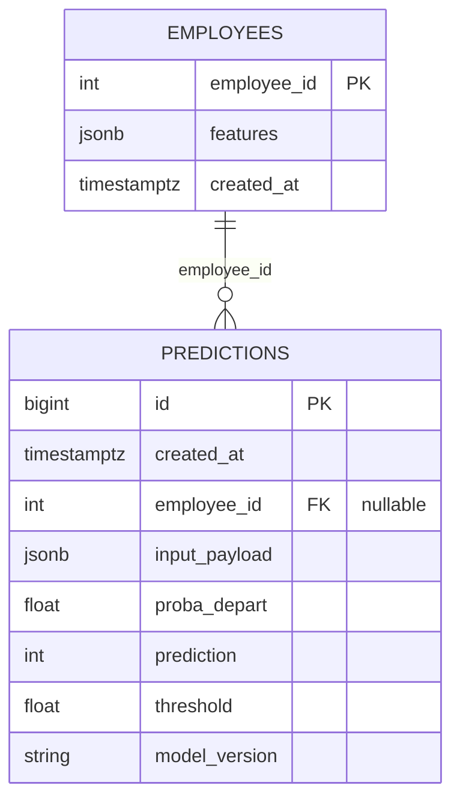

# The database

PostgreSQL holds the decision log. Each prediction the service makes is written as a row with
the probability, the threshold and the model version, so the decision can be examined later
together with the values that produced it.

The database has three uses. It holds employee features, so that `/predict_by_id` can score an
employee from an id. It records each prediction. It returns that history through `/history`
and `/history/{employee_id}`.

The write is best-effort. When it fails, the route still returns its answer, with
`stored: false`, and no row is written.

## Schema



### `employees`

One row per seeded employee. `/predict_by_id/{employee_id}` reads `features` from this table.

| Column | Type | Role |
|---|---|---|
| `employee_id` | INTEGER (PK) | identifier set by the seed script |
| `features` | JSONB | the model's input features |
| `created_at` | TIMESTAMPTZ | insertion time |

### `predictions`

The decision log. The service only inserts into this table and never updates a row.

| Column | Type | Role |
|---|---|---|
| `id` | BIGSERIAL (PK) | prediction id |
| `created_at` | TIMESTAMPTZ | time of the call |
| `employee_id` | INTEGER (FK, nullable) | set when scored by id |
| `input_payload` | JSONB | the payload as scored, after normalisation |
| `proba_depart` | DOUBLE | predicted probability, calibrated |
| `prediction` | SMALLINT | the decision, 0 or 1 |
| `threshold` | DOUBLE | the threshold that decided it |
| `model_version` | TEXT | the model version that scored |

`employee_id` is nullable because two routes write to this table. `/predict` receives a payload
and has no employee to refer to, and `/predict_by_id` receives an id and reads the features
from `employees`.

The payload is stored as JSONB because the feature set can change over a model's life. A new
field needs no migration, and the stored payload keeps every field of the request, including
fields that had no column when the table was created. The service stores the payload after
converting gender and overtime to integers, which is the form the model scored.

One index on `predictions.created_at` serves the ordering of the history routes, and one on
`predictions.employee_id` serves the history of a single employee. No GIN index is defined on
the JSONB column, since no query filters on the content of the payload.

## SQL and scripts

| File | What it does |
|---|---|
| `sql/serving/01_schema.sql` | tables and indexes, idempotent |
| `sql/serving/02_seed_checks.sql` | inspection queries, optional |
| `sql/02_clean_views.sql` … `sql/05_group_stats.sql` | the exploratory views: cleaning, joins, group statistics |
| `scripts/db_apply_schema.py` | applies `01_schema.sql`; safe to rerun |
| `scripts/db_seed_employees.py` | seeds the ten request fixtures |
| `scripts/db_smoke_test.py` | connectivity and row counts |
| `scripts/db_run_checks.py` | replays `02_seed_checks.sql` statement by statement and prints what each returns |
| `scripts/load_raw_to_postgres.py` | loads the three extracts so the exploratory views have something to read |

The scripts that read files under `sql/serving/` open them relative to the working directory,
so they must be run from the repository root.

The exploratory views serve analysis, and the API never queries them. In 201 lines of SQL, they
clean, join and summarise the three extracts inside the database, which the first notebooks do
in pandas.

## Seed data

`scripts/db_seed_employees.py` inserts the ten rows of `tests/fixtures/employees_sample.json`
into `employees`, with ids 1 to 10, so that `/predict_by_id` has employees to score. The
integration tests send the first of these rows to `/predict` as a request payload. When
`ENV_FILE` is `.env.local`, the default, the script first deletes every row of `predictions` and
`employees`.

The full extract is neither seeded nor committed. [`data-source.md`](data-source.md) describes
it, a public and fictional dataset, explains why the repository does not redistribute it, and
gives the steps to rebuild it.

## Useful queries

```sql
SELECT COUNT(*) FROM employees;     -- is the seed there
SELECT COUNT(*) FROM predictions;   -- was anything logged

SELECT id, created_at, employee_id, proba_depart, prediction, threshold, model_version
FROM predictions
ORDER BY created_at DESC
LIMIT 10;
```

From the host, without a psql client:

```bash
docker exec -it attrition_postgres psql -U attrition -d attrition_serving \
  -c "SELECT id, created_at, employee_id, proba_depart, prediction, threshold, model_version FROM predictions ORDER BY created_at DESC LIMIT 10;"
```

## What the log records

Each row of `predictions` is one decision that the service managed to write, and the service
never updates a row. `input_payload` holds the payload exactly as it was scored, so the
decision can be recomputed from it with the same model. `model_version` and `threshold` are
stored with the probability, so a decision taken months earlier can be explained without
guessing which model and which threshold produced it.

Two operations remove rows. The seed script empties both tables in the local setup, as
described above, and the integration tests empty `predictions` before each test on the
database they connect to.
